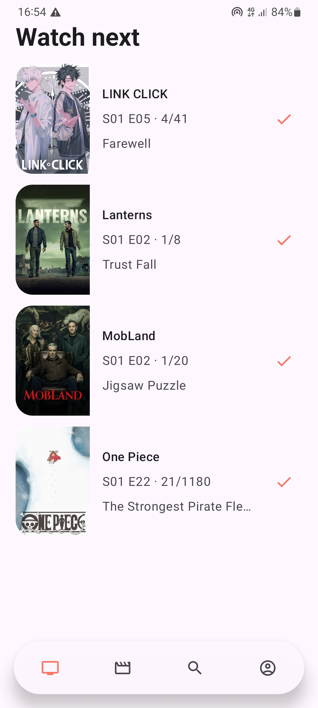
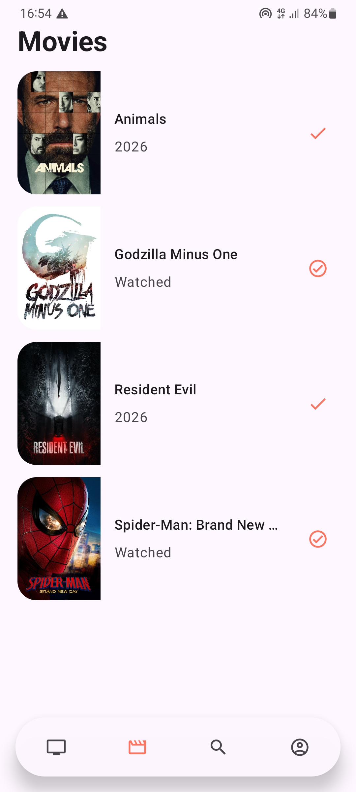
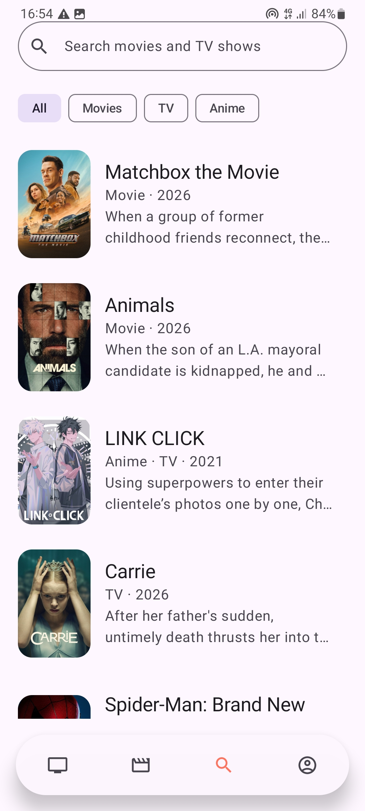
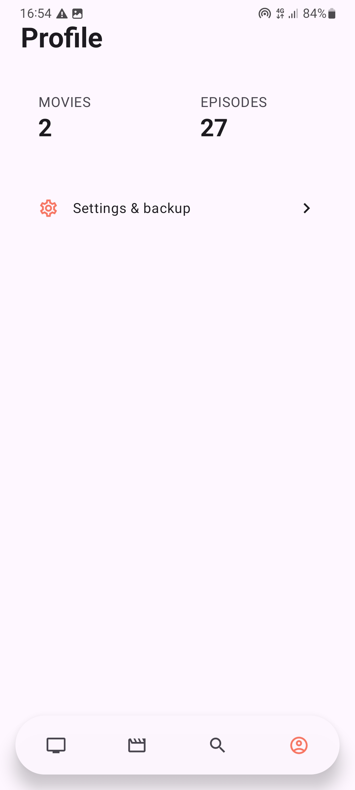
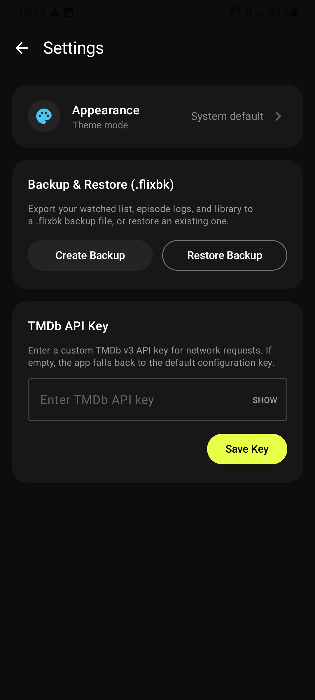

# Flix-Sync

<p align="center">
  <strong>An offline-first personal tracker for movies, TV series, anime, seasons, and episodes.</strong>
</p>

<p align="center">
  Track what you watch, find the next unwatched episode, and keep your history under your control.
</p>

<p align="center">
  
  
  
  
  
  
  
</p>

---

## Overview

Flix-Sync is a focused Android application for maintaining a personal movie and television library without accounts, social features, or mandatory cloud storage.

The app uses Room as its reactive single source of truth. Library membership, movie status, episode progress, metadata, and statistics are persisted locally and exposed through Kotlin `Flow`, allowing the interface to remain consistent across navigation, configuration changes, and process restarts.

Network access is used to search TMDb and hydrate uncached metadata. Previously cached library data and tracking operations remain available offline.

## Features

- Track movies, TV series, and anime in one personal library.
- Find the actual next unwatched episode across seasons.
- Mark individual episodes watched or unwatched.
- Mark the next available episode with one action.
- Handle episode gaps and season transitions correctly.
- Mark movies watched or unwatched.
- Search TMDb across movies and television titles.
- Filter search results by All, Movies, TV, or Anime.
- View posters, backdrops, release information, runtime, and synopsis.
- Keep anime as a TV classification without creating duplicate records.
- Remove a title while retaining its history or purge both title and history.
- View real watched movie and episode counts derived from Room.
- Choose System, Dark, or Light appearance.
- Configure a custom TMDb API key from the app.
- Export and restore transactional `.flixbk` backups.
- Create rolling background backups every 24 hours with WorkManager.
- Continue using cached library data and watch controls offline.

## Screenshots

<p align="center">
  
  
  
  
  
</p>

| Watch Next | Movies | Search | Profile | Settings |
|:---:|:---:|:---:|:---:|:---:|
| Episode progress and quick tracking | Personal movie library | TMDb search and filters | Persisted watch statistics | Theme, API key, and backups |

## Design

Flix-Sync uses a poster-led Material 3 interface designed for quick, one-handed tracking.

The visual system emphasizes:

- A dark cinematic background.
- Neon-lime `#E8FF47` accents.
- Rounded poster cards and content surfaces.
- A floating four-item bottom navigation bar.
- Clear progress and next-episode information.
- Edge-to-edge layouts with system inset support.
- Scrollable, responsive screens suitable for smaller devices.
- Consistent System, Dark, and Light appearance modes.

## Architecture

Flix-Sync follows a small, layered architecture built around persisted state:

```text
┌──────────────────────────────────────────────────────────┐
│                     Presentation                         │
│                                                          │
│  Jetpack Compose screens                                 │
│          │                                               │
│          ▼                                               │
│  Hilt ViewModels                                         │
│  StateFlow + lifecycle-aware collection                  │
└──────────────────────────┬───────────────────────────────┘
                           │
                           ▼
┌──────────────────────────────────────────────────────────┐
│                        Domain                            │
│                                                          │
│  Media and episode models                               │
│  Repository contracts                                   │
│  Progress and next-episode rules                        │
└──────────────────────────┬───────────────────────────────┘
                           │
                           ▼
┌──────────────────────────────────────────────────────────┐
│                         Data                             │
│                                                          │
│  Room database ───────── Reactive local source of truth │
│       │                                                  │
│       ├── Media metadata and library membership         │
│       ├── Episode metadata                              │
│       └── Watched movie and episode records             │
│                                                          │
│  Retrofit + TMDb ─────── Search and metadata hydration  │
│  WorkManager ─────────── Scheduled local backups        │
│  DataStore ───────────── Theme and API-key preferences  │
└──────────────────────────────────────────────────────────┘
```

### Data layer

The data layer owns persistence, remote requests, migrations, backup handling, and transactional tracking operations.

Room stores:

- Media metadata.
- Explicit library membership.
- Season and episode metadata.
- Watched movie records.
- Watched episode records.

Retrofit retrieves uncached discovery, search, title, season, and episode information from TMDb.

### Domain layer

The domain layer contains application-facing models and repository contracts. Progress is calculated with season and episode identity rather than using a maximum episode number across unrelated seasons.

### Presentation layer

ViewModels derive interface state from repository flows and expose immutable `StateFlow` values. Compose collects these streams lifecycle-aware, avoiding parallel in-memory copies of persisted tracking state.

## Data Integrity

### Room as the reactive source of truth

Room is authoritative for:

- Library membership.
- Movie watched status.
- Episode watched status.
- Episode progress.
- Profile statistics.

The interface observes Room flows and converts them to ViewModel state with `stateIn()`. UI event handlers dispatch database operations instead of directly modifying a competing progress map.

### Namespaced media identifiers

TMDb may assign the same numeric ID to a movie and a television title. Flix-Sync therefore uses namespaced identifiers:

```text
movie:42
tv:42
```

This prevents movie and television records from overwriting or sharing history with one another.

### Idempotent episode tracking

Episode watch records use a natural composite identity:

```text
mediaKey + seasonNumber + episodeNumber
```

Repeated or rapid watch actions cannot create duplicate records for the same episode.

### Safe metadata refresh

User history is stored separately from refreshable metadata. Updating a poster, synopsis, runtime, or release date does not replace the parent record in a way that could cascade-delete tracking data.

### Non-destructive migration

The version 1 to version 2 Room migration:

- Converts numeric media IDs into namespaced keys.
- Preserves existing watch records.
- Deduplicates repeated episode logs.
- Converts legacy anime records into TV-backed media identities.
- Avoids destructive database recreation.

Legacy data that did not contain explicit library membership cannot perfectly distinguish cached discovery results from deliberately added but unwatched titles. Watched legacy titles are retained as library entries so recorded history is not silently lost.

## Backup and Restore

Flix-Sync uses the `.flixbk` extension for portable JSON backups.

A backup contains:

- Backup format version.
- Creation timestamp.
- Library and cached media metadata.
- Namespaced media identities.
- Watched movie and episode records.
- Cached episode metadata.
- Supported settings data.

Restore operations are transactional. Existing data is replaced only as one database transaction, preventing a partially restored library if an operation fails.

Older backups are accepted where their data can be mapped safely. Legacy records without a namespaced key are reconstructed from their media type and TMDb ID. When an old backup is inherently ambiguous, Flix-Sync favors preserving history over silently deleting it.

WorkManager also schedules an automated backup approximately every 24 hours. Automated backups are written to the app-specific external files directory, and only the five most recent automated backup files are retained.

> Backups are local files. Flix-Sync does not upload watch history to a cloud service.

## Technology Stack

- [Kotlin](https://kotlinlang.org/) — application language.
- [Jetpack Compose](https://developer.android.com/compose) — declarative UI.
- [Material 3](https://m3.material.io/) — components and theming.
- [Room](https://developer.android.com/training/data-storage/room) — local SQLite persistence.
- [Kotlin Coroutines and Flow](https://kotlinlang.org/docs/coroutines-overview.html) — asynchronous and reactive state.
- [Retrofit](https://square.github.io/retrofit/) — TMDb networking.
- [OkHttp](https://square.github.io/okhttp/) — HTTP transport and API-key interception.
- [Dagger Hilt](https://dagger.dev/hilt/) — dependency injection.
- [WorkManager](https://developer.android.com/topic/libraries/architecture/workmanager) — scheduled backups.
- [DataStore](https://developer.android.com/topic/libraries/architecture/datastore) — application preferences.
- [Coil](https://coil-kt.github.io/coil/compose/) — poster and backdrop loading.
- [Kotlin Serialization](https://github.com/Kotlin/kotlinx.serialization) — backup encoding and decoding.

## Getting Started

### Prerequisites

Install:

- Android Studio with Android SDK support.
- JDK 11 or a compatible Android Studio bundled JDK.
- Android SDK Platform 36.
- An Android device or emulator running Android 11/API 30 or newer.
- A TMDb API key for search and metadata requests.

### Clone the repository

```bash
git clone https://github.com/your-username/Flix-Sync.git
cd Flix-Sync
```

### Configure the TMDb API key

Create or update `local.properties` in the repository root:

```properties
sdk.dir=/path/to/your/Android/Sdk
TMDB_API_KEY="your_tmdb_v3_api_key"
```

On Windows, the SDK path commonly resembles:

```properties
sdk.dir=C\:\\Users\\YourName\\AppData\\Local\\Android\\Sdk
TMDB_API_KEY="your_tmdb_v3_api_key"
```

The key can also be changed from the application settings screen.

Do not commit a real API key. Keep `local.properties` excluded through `.gitignore`.

You can request a TMDb API key from the [TMDb developer portal](https://developer.themoviedb.org/docs/getting-started).

### Build the debug application

macOS or Linux:

```bash
./gradlew assembleDebug
```

Windows:

```powershell
.\gradlew.bat assembleDebug
```

The generated APK is located at:

```text
app/build/outputs/apk/debug/app-debug.apk
```

### Install on a connected device

macOS or Linux:

```bash
./gradlew installDebug
```

Windows:

```powershell
.\gradlew.bat installDebug
```

Alternatively:

```bash
adb install -r app/build/outputs/apk/debug/app-debug.apk
```

## Testing

### JVM unit tests

macOS or Linux:

```bash
./gradlew testDebugUnitTest
```

Windows:

```powershell
.\gradlew.bat testDebugUnitTest
```

The unit suite covers progress behavior including:

- Watched gaps.
- Correct season transitions.
- Movie and TV namespace isolation.

### Instrumented Room tests

Start an emulator or connect an Android device, then run:

```bash
./gradlew connectedDebugAndroidTest
```

On Windows:

```powershell
.\gradlew.bat connectedDebugAndroidTest
```

The Room regression suite verifies:

- Unwatching one movie does not affect another.
- Metadata refresh does not erase history.
- Repeated episode marking remains idempotent.
- Movie and TV records with the same numeric ID coexist.
- Transactional restore preserves media, episodes, and watch records.
- Version 1 to version 2 migration preserves and deduplicates tracking data.

### Full local verification

macOS or Linux:

```bash
./gradlew testDebugUnitTest connectedDebugAndroidTest assembleDebug
```

Windows:

```powershell
.\gradlew.bat testDebugUnitTest connectedDebugAndroidTest assembleDebug
```

## Project Structure

```text
app/src/main/java/com/example/flixsync/
├── data/
│   ├── local/
│   │   ├── dao/
│   │   ├── entity/
│   │   └── AppDatabase.kt
│   ├── remote/
│   │   └── dto/
│   └── repository/
├── di/
├── domain/
│   ├── model/
│   └── repository/
├── presentation/
│   ├── detail/
│   ├── home/
│   └── settings/
├── service/
├── ui/
│   └── theme/
├── FlixSyncApplication.kt
└── MainActivity.kt
```

## Privacy

Flix-Sync does not require an account.

Your library and watch history are stored locally in the application database. The configured TMDb API key is stored in application preferences. Search terms and metadata requests are sent to TMDb when network features are used.

Exported `.flixbk` files contain personal watch history. Store and share them accordingly.

## Contributing

Contributions are welcome.

1. Fork the repository.
2. Create a focused branch:

   ```bash
   git checkout -b feature/short-description
   ```

3. Make and test your changes.
4. Verify unit and instrumentation tests where applicable.
5. Open a pull request describing the behavior changed and how it was verified.

Please keep changes focused and preserve the core principles of offline-first behavior, Room-backed state, targeted data mutations, and non-destructive migrations.

## Attribution

This product uses the TMDb API but is not endorsed or certified by TMDb.

Movie, television, poster, backdrop, and related metadata are provided by [The Movie Database](https://www.themoviedb.org/).

Android, Jetpack Compose, Material 3, Room, WorkManager, and related libraries are trademarks or projects of their respective owners.

## License

Flix-Sync is available under the [MIT License](LICENSE).

Copyright © Flix-Sync contributors.
